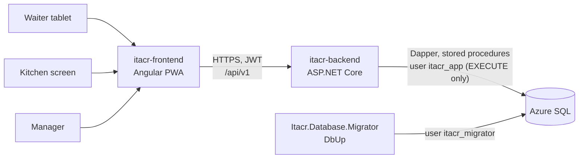
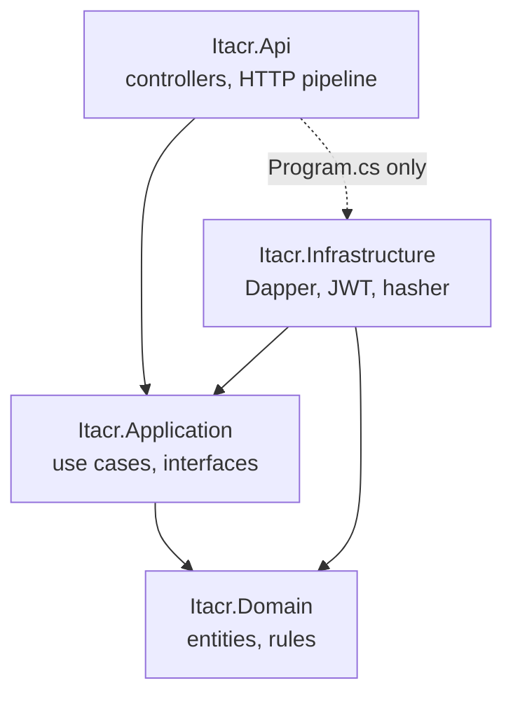
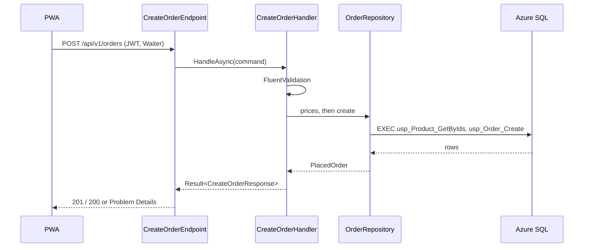
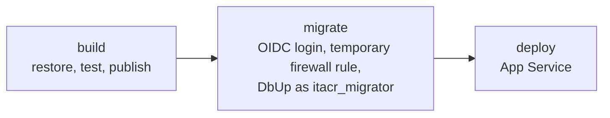

# Architecture: itacr-backend

How the ITACR API is built and why. The day-to-day rules (naming, folders, tests) live in [CODING_STANDARDS.md](CODING_STANDARDS.md); this document is the map.

## Table of contents

1. [System context](#1-system-context)
2. [Layers](#2-layers)
3. [Request flow](#3-request-flow)
4. [Data access](#4-data-access)
5. [Database lifecycle](#5-database-lifecycle)
6. [Security](#6-security)
7. [Testing strategy](#7-testing-strategy)
8. [Deployment](#8-deployment)
9. [Key decisions](#9-key-decisions)

## 1. System context

- The PWA is the only client. It talks to the REST API under `/api/v1`.
- The API is an Azure App Service. It reaches Azure SQL with a user that can only run stored procedures.
- The migrator runs in the deploy workflow, before the API is deployed, and is the only thing that changes the schema.

## 2. Layers

Clean Architecture with four projects. References point inward only.

| Project                | Owns                                                                                                                                                                                  | Never contains              |
| ---------------------- | ------------------------------------------------------------------------------------------------------------------------------------------------------------------------------------- | --------------------------- |
| `Itacr.Domain`         | Entities, enums, and rules without I/O (`Order` status transitions, channel and table rule)                                                                                           | Packages, I/O               |
| `Itacr.Application`    | One folder per use case (`Orders/CreateOrder`): command or query, validator, handler, response. The interfaces the use cases need (`IOrderRepository`, `IDbSession`, `ITokenService`) | ASP.NET Core, Dapper, SQL   |
| `Itacr.Infrastructure` | Implementations: Dapper repositories, `DbSession`, JWT, the PBKDF2 credential hasher                                                                                                  | Business rules              |
| `Itacr.Api`            | One `[ApiController]` per use case, the pipeline, options, error mapping                                                                                                              | Business logic, data access |

Code is organized by **module and use case** with the same names in every project (`Identity`, `Catalog`, `Orders`, `Kitchen`, `Notifications`), so a story touches folders with the same name in each layer.

`tests/Itacr.Architecture.Tests` (NetArchTest) fails the build when a rule is broken: layer references, handlers calling handlers, a handler without its endpoint, or repositories that are not `internal sealed`.

## 3. Request flow

Example: `POST /api/v1/orders` (HU_03).

1. **Pipeline** (`Common/WebApplicationExtensions.cs`): exception handler, security headers, HSTS and HTTPS outside development, CORS, rate limiting, authentication, authorization, controllers. Every endpoint needs a JWT unless it allows anonymous access explicitly (login, health, and OpenAPI in development).
2. **Endpoint**: binds the body, builds the command, calls the handler, and turns the result into a response with `this.ToActionResult(error)`. Binding errors become Spanish Problem Details (`InvalidRequestResponse`).
3. **Handler**: validates with FluentValidation (camelCase keys, Spanish messages), applies the rules, and returns `Result<T>`. It never throws for expected failures.
4. **Errors**: an `Error` has a kind (`Validation`, `Unauthorized`, `Forbidden`, `NotFound`, `Conflict`, `Locked`) that maps to 400, 401, 403, 404, 409, or 423 with an RFC 9457 Problem Details body.

## 4. Data access

- **Dapper over stored procedures only.** The API never sends ad hoc SQL. Every query lives in `database/procedures/<Module>/` or `database/functions/<Module>/`, so the SQL is reviewed in the same PR as the code that calls it.
- **`DbSession`** (scoped) opens one connection per request. It retries only while opening the connection (transient Azure SQL errors), never a command, so nothing runs twice. Transactions are explicit through `ExecuteInTransactionAsync`.
- **Keys** are `SequentialGuid` values made in C#, so inserts do not fragment the clustered index and rows sort in the order they were created.
- **Idempotency**: `POST /orders` carries a `clientOrderId` made by the PWA. A repeated request returns the order that already exists (200) instead of creating a second one.
- **Dates** are UTC `datetime2`.

Details: [CODING_STANDARDS.md §3](CODING_STANDARDS.md#3-database-azure-sql--dbup) and [database.md](database.md).

## 5. Database lifecycle

`database/Itacr.Database.Migrator` (DbUp) owns the schema:

| Folder                                             | Runs                                   | Content                                                            |
| -------------------------------------------------- | -------------------------------------- | ------------------------------------------------------------------ |
| `migrations/`                                      | Once, in order (`V001__`, `V002__`, …) | Tables, indexes, constraints, seed data                            |
| `functions/`, `views/`, `procedures/`, `triggers/` | Every time                             | `CREATE OR ALTER` objects, so the database always matches the repo |
| `Seeding/` (C#)                                    | Every time, idempotent                 | Test employees with hashed credentials (development)               |

`database/scripts/security/` holds the scripts that create the two users. The passwords are never in the repo.

## 6. Security

| Concern        | How                                                                                                                                     |
| -------------- | --------------------------------------------------------------------------------------------------------------------------------------- |
| Authentication | JWT bearer tokens, signed with `Jwt:Secret` (App Service setting). Login by password (manager) or PIN (staff)                           |
| Authorization  | Role policies per endpoint (`Waiter`, `Kitchen`, `Manager`); everything else requires a signed-in user                                  |
| Credentials    | PBKDF2 through `PasswordHasher<Employee>`, rehashed on login when the parameters change. PIN lockout updated atomically in the database |
| Brute force    | Rate limiting policy on the login and PIN reset endpoints                                                                               |
| HTTP           | `nosniff`, `X-Frame-Options: DENY`, `Referrer-Policy: no-referrer`, HSTS, CORS limited to the PWA origins                               |
| Database       | `itacr_app` has EXECUTE only (no table access); `itacr_migrator` changes the schema; a test checks the permissions                      |
| Secrets        | Never in the repo: App Service settings, GitHub secrets, and OIDC for Azure                                                             |

## 7. Testing strategy

| Project                         | Scope                                                              | Infrastructure                                                                                        |
| ------------------------------- | ------------------------------------------------------------------ | ----------------------------------------------------------------------------------------------------- |
| `Itacr.Architecture.Tests`      | Layer and use case rules                                           | None                                                                                                  |
| `Itacr.Api.Tests`               | Endpoints end to end: HTTP → handler → procedure → SQL             | Testcontainers SQL Server, shared per run, reset between tests, API connected as an EXECUTE-only user |
| `Itacr.Database.Migrator.Tests` | Migrations, `CREATE OR ALTER` objects, seeding, schema conventions | Testcontainers SQL Server                                                                             |

The SQL Server image is pinned (`2025-CU9`) and the tests run with `-m:1` in CI to stay inside the runner's memory.

## 8. Deployment

- `ci.yml` runs on every PR: format, build, all tests, commit message and branch name checks.
- `deploy.yml` runs on `main` (production) and on `release` (QA, with its own App Service `app-itacr-backend-qa`, database `itacr-qa`, and the test employees). The migrator logs in to Azure with OIDC (no stored Azure password), opens a firewall rule only for the runner, migrates, and removes the rule. The API is deployed only if the migration succeeded.
- `release-please.yml` versions the API and writes the CHANGELOG from the commit messages.

## 9. Key decisions

| Decision                                   | Instead of                                 | Why                                                                         |
| ------------------------------------------ | ------------------------------------------ | --------------------------------------------------------------------------- |
| Clean Architecture by module and use case  | One project, or folders by technical type  | Each story changes one folder per layer; the rules are enforced by tests    |
| Dapper + stored procedures (ITACR-36)      | EF Core                                    | The SQL is explicit and reviewed; the app user can be EXECUTE only          |
| DbUp migrator as its own step (ITACR-37)   | EF migrations at startup                   | The API never needs schema permissions; a failed migration stops the deploy |
| One controller per use case (ITACR-38)     | Minimal APIs, or one controller per module | Same shape as the use cases; attributes for auth and OpenAPI                |
| `Result<T>` + Problem Details (ITACR-38)   | Exceptions for expected failures           | Explicit control flow; one error format for the PWA                         |
| Client-generated `clientOrderId` (ITACR-9) | Server-only ids                            | Safe retries from tablets with unstable networks                            |
