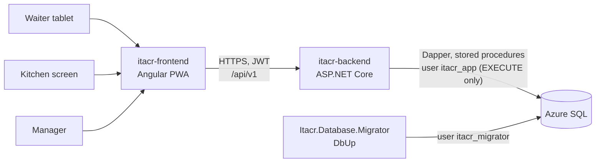
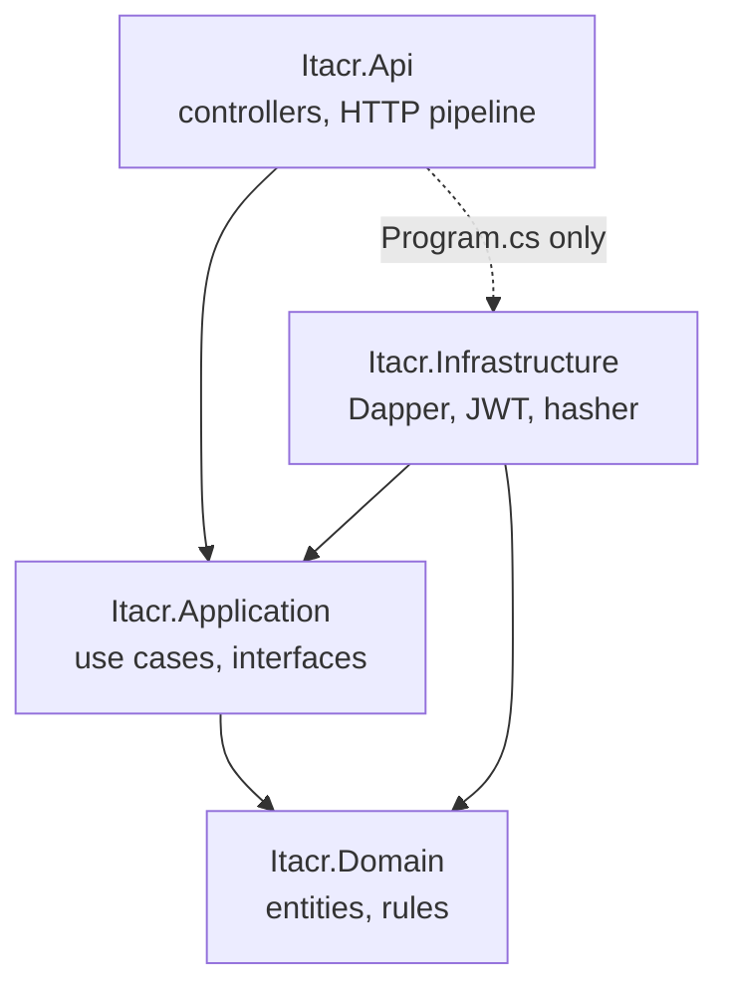
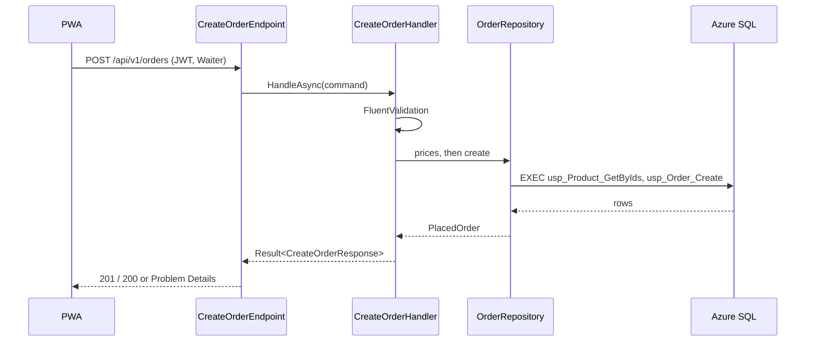
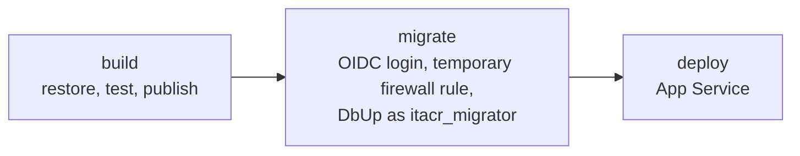

# Architecture: itacr-backend

How the ITACR API is built and why. The day-to-day rules (naming, folders, tests) live in [CODING_STANDARDS.md](CODING_STANDARDS.md); this document is the map.

## Table of contents

1. [System context](#1-system-context)
2. [Layers](#2-layers)
3. [Request flow](#3-request-flow)
4. [Data access](#4-data-access)
5. [Database lifecycle](#5-database-lifecycle)
6. [Security](#6-security)
7. [Testing strategy](#7-testing-strategy)
8. [Deployment](#8-deployment)
9. [Key decisions](#9-key-decisions)

## 1. System context

- The PWA is the only client. It talks to the REST API under `/api/v1`.
- The API is an Azure App Service. It reaches Azure SQL with a user that can only run stored procedures.
- The migrator runs in the deploy workflow, before the API is deployed, and is the only thing that changes the schema.

## 2. Layers

Clean Architecture with four projects. References point inward only.

| Project                | Owns                                                                                                                                                                                  | Never contains              |
| ---------------------- | ------------------------------------------------------------------------------------------------------------------------------------------------------------------------------------- | --------------------------- |
| `Itacr.Domain`         | Entities, enums, and rules without I/O (`Order` status transitions, channel and table rule)                                                                                           | Packages, I/O               |
| `Itacr.Application`    | One folder per use case (`Orders/CreateOrder`): command or query, validator, handler, response. The interfaces the use cases need (`IOrderRepository`, `IDbSession`, `ITokenService`) | ASP.NET Core, Dapper, SQL   |
| `Itacr.Infrastructure` | Implementations: Dapper repositories, `DbSession`, JWT, the PBKDF2 credential hasher                                                                                                  | Business rules              |
| `Itacr.Api`            | One `[ApiController]` per use case, the pipeline, options, error mapping                                                                                                              | Business logic, data access |

Code is organized by **module and use case** with the same names in every project (`Identity`, `Catalog`, `Orders`, `Kitchen`, `Notifications`), so a story touches folders with the same name in each layer.

`tests/Itacr.Architecture.Tests` (NetArchTest) fails the build when a rule is broken: layer references, handlers calling handlers, a handler without its endpoint, or repositories that are not `internal sealed`.

## 3. Request flow

Example: `POST /api/v1/orders` (HU_03).

1. **Pipeline** (`Common/WebApplicationExtensions.cs`): exception handler, security headers, HSTS and HTTPS outside development, CORS, rate limiting, authentication, authorization, controllers. Every endpoint needs a JWT unless it allows anonymous access explicitly (login, health, and OpenAPI in development).
2. **Endpoint**: binds the body, builds the command, calls the handler, and turns the result into a response with `this.ToActionResult(error)`. Binding errors become Spanish Problem Details (`InvalidRequestResponse`).
3. **Handler**: validates with FluentValidation (camelCase keys, Spanish messages), applies the rules, and returns `Result<T>`. It never throws for expected failures.
4. **Errors**: an `Error` has a kind (`Validation`, `Unauthorized`, `Forbidden`, `NotFound`, `Conflict`, `Locked`) that maps to 400, 401, 403, 404, 409, or 423 with an RFC 9457 Problem Details body.

## 4. Data access

- **Dapper over stored procedures only.** The API never sends ad hoc SQL. Every query lives in `database/procedures/<Module>/` or `database/functions/<Module>/`, so the SQL is reviewed in the same PR as the code that calls it.
- **`DbSession`** (scoped) opens one connection per request. It retries only while opening the connection (transient Azure SQL errors), never a command, so nothing runs twice. Transactions are explicit through `ExecuteInTransactionAsync`.
- **Keys** are `SequentialGuid` values made in C#, so inserts do not fragment the clustered index and rows sort in the order they were created.
- **Idempotency**: `POST /orders` carries a `clientOrderId` made by the PWA. A repeated request returns the order that already exists (200) instead of creating a second one.
- **Dates** are UTC `datetime2`.

Details: [CODING_STANDARDS.md §3](CODING_STANDARDS.md#3-database-azure-sql--dbup) and [database.md](database.md).

## 5. Database lifecycle

`database/Itacr.Database.Migrator` (DbUp) owns the schema:

| Folder                                             | Runs                                   | Content                                                            |
| -------------------------------------------------- | -------------------------------------- | ------------------------------------------------------------------ |
| `migrations/`                                      | Once, in order (`V001__`, `V002__`, …) | Tables, indexes, constraints, seed data                            |
| `functions/`, `views/`, `procedures/`, `triggers/` | Every time                             | `CREATE OR ALTER` objects, so the database always matches the repo |
| `Seeding/` (C#)                                    | Every time, idempotent                 | Test employees with hashed credentials (development)               |

`database/scripts/security/` holds the scripts that create the two users. The passwords are never in the repo.

## 6. Security

| Concern        | How                                                                                                                                     |
| -------------- | --------------------------------------------------------------------------------------------------------------------------------------- |
| Authentication | JWT bearer tokens, signed with `Jwt:Secret` (App Service setting). Login by password (manager) or PIN (staff)                           |
| Authorization  | Role policies per endpoint (`Waiter`, `Kitchen`, `Manager`); everything else requires a signed-in user                                  |
| Credentials    | PBKDF2 through `PasswordHasher<Employee>`, rehashed on login when the parameters change. PIN lockout updated atomically in the database |
| Brute force    | Rate limiting policy on the login and PIN reset endpoints                                                                               |
| HTTP           | `nosniff`, `X-Frame-Options: DENY`, `Referrer-Policy: no-referrer`, HSTS, CORS limited to the PWA origins                               |
| Database       | `itacr_app` has EXECUTE only (no table access); `itacr_migrator` changes the schema; a test checks the permissions                      |
| Secrets        | Never in the repo: App Service settings, GitHub secrets, and OIDC for Azure                                                             |

### 6.1 Public endpoints and rate limits

Every controller requires a signed-in user (`AuthorizeFilter`) unless it says `[AllowAnonymous]` on purpose. These are all the public endpoints. Every request also counts against the global limit of `RateLimiting` (100 per minute per client IP), on top of the limit of its own policy.

| Endpoint | What it does | Policy and limit per client IP | Notes |
| -------- | ------------ | ------------------------------ | ----- |
| `GET /api/v1/health` | Health probe of the App Service | global | Reveals no internal details |
| `GET /api/v1/catalog/categories`, `GET /api/v1/catalog/products` | The menu | global | Read-only, same for everyone |
| `GET /api/v1/auth/employees?role=` | The people shown in the PIN picker | global | Returns only `id` and an abbreviated display name of **active** employees |
| `POST /api/v1/auth/login/pin`, `POST /api/v1/auth/login/password`, `POST /api/v1/auth/pin-reset-requests` | Staff sign-in | `login`: 10 per minute (`LoginSecurity`) | A PIN also locks for 15 minutes after 5 failures |
| `POST /api/v1/public/orders` *(HU_06)* | A customer sends a pickup order | `public-order-create`: **10 per 10 minutes** | The first public endpoint that creates data; see [6.2](#62-customer-pickup-orders-hu_06) |
| `GET /api/v1/public/orders/{clientOrderId}` *(HU_06)* | A customer follows their order | `public-order-status`: **60 per minute** | Read-only, answers with the minimum; see [6.2](#62-customer-pickup-orders-hu_06) |
| OpenAPI and Scalar | API docs | Development only | Not mapped in QA or production |

Rules for any public endpoint, today and later:

- It is named explicitly in this table, in the PR that adds it, and has a test that proves it needs no token **and** a test that proves its limit (`429`).
- It lives under `/api/v1/public/` when it creates or reads customer data, so an audit of the public surface is one search.
- Limits are options validated at startup (`PublicOrders` section, same pattern as `LoginSecurity`), never constants in code.
- It never returns an employee id, a customer phone, or an id that another endpoint accepts as a credential.

**To verify in HU_06:** the limits are per client IP, so the limiter must see the customer's real address. Behind the App Service front end `RemoteIpAddress` can be the proxy's address, which would put every customer in one bucket. The API does not configure forwarded headers today. Check it in QA and, if needed, add `UseForwardedHeaders` limited to the App Service proxy before opening the endpoints.

### 6.2 Customer pickup orders (HU_06)

A customer without an employee account sends an order from the phone and later follows it. There is no login, so every control lives in the endpoint and in the data. Decided in ITACR-42.

**What is asked.** Only the name and the phone:

| Field | Rule |
| ----- | ---- |
| `name` | Required, trimmed, 2 to 60 characters, no control characters |
| `phone` | Required, exactly 10 digits (digits only, no spaces or `+52`), and not a trivial number (`0000000000`, one repeated digit, or `1234567890`) |
| `clientOrderId` | A GUID generated on the phone, as in the waiter flow |
| `items` | `productId` and `quantity` only |

Messages are in Spanish and come from the use case validator ("Este campo es obligatorio." when the phone is missing, CA2 of HU_06). The request has no `tableId`, `waiterId`, `channel`, or price: if it carries them they are ignored.

**What the server decides.**

- The order is created with channel `MobileApp`, status `New`, `CustomerId` set, and no table and no waiter. Prices always come from `dbo.Products`.
- Orders are idempotent on `clientOrderId` like the waiter ones: sending it again returns the order already saved (`200`) instead of a duplicate. An order that belongs to another customer answers `409`.
- Stricter limits than the waiter flow: at most **20 products** and a quantity of **1 to 10** per product (the waiter allows 50 and 99).
- At most **2 active orders per phone** (status New, InPreparation, or Ready). The third answers `409` with a Spanish message. This keeps a script from filling the kitchen board with one phone number, and a person with one real phone from sending the same order again and again.
- The order appears on the kitchen board as "Cliente · Para recoger" with no change to the board.

**How the customer follows the order.** The phone keeps the `clientOrderId` (it is the receipt). `GET /api/v1/public/orders/{clientOrderId}` returns only the order number, status, product names and quantities, total, and creation time. A random GUID is 122 bits, so it cannot be guessed, and an unknown id answers `404` like any other. It never returns the name or the phone. The order number is shown for the counter but is **not** a key (it is sequential and easy to guess).

Known limit: if the customer clears the browser data, the phone forgets the receipt and the order can no longer be followed from the app. They can still give their order number at the counter. Looking an order up by number and phone from another device is left for a later story.

**Personal data.** The name and phone are personal data under the Mexican data protection law. The form shows a short privacy notice, the phone is masked in any staff screen that shows it, and neither value is written to logs. The retention period (how long a customer is kept) is not decided yet and is listed as an open question below.

**Protection that was left out on purpose.** No CAPTCHA and no honeypot field for now: the limits and the per-phone rule are enough for the first release. If real abuse appears, a CAPTCHA (for example Cloudflare Turnstile) goes in front of `POST /api/v1/public/orders` as its own task.

**Known gap.** There is no cancelled or rejected status, so the kitchen cannot discard an order that is obviously fake. The mitigation today is the limits above. A reject action for managers should be planned with the next kitchen story.

**Open questions (for the Sprint 3 review).**

1. How long are customers kept? (Proposal: delete customers with no order in the last 90 days.)
2. Does the kitchen need to see the customer's name to call out a pickup order? The kitchen queue does not return it today.

## 7. Testing strategy

| Project                         | Scope                                                              | Infrastructure                                                                                        |
| ------------------------------- | ------------------------------------------------------------------ | ----------------------------------------------------------------------------------------------------- |
| `Itacr.Architecture.Tests`      | Layer and use case rules                                           | None                                                                                                  |
| `Itacr.Api.Tests`               | Endpoints end to end: HTTP → handler → procedure → SQL             | Testcontainers SQL Server, shared per run, reset between tests, API connected as an EXECUTE-only user |
| `Itacr.Database.Migrator.Tests` | Migrations, `CREATE OR ALTER` objects, seeding, schema conventions | Testcontainers SQL Server                                                                             |

The SQL Server image is pinned (`2025-CU9`) and the tests run with `-m:1` in CI to stay inside the runner's memory.

## 8. Deployment

- `ci.yml` runs on every PR: format, build, all tests, commit message and branch name checks.
- `deploy.yml` runs on `main` (production) and on `release` (QA, with its own App Service `app-itacr-backend-qa`, database `itacr-qa`, and the test employees). The migrator logs in to Azure with OIDC (no stored Azure password), opens a firewall rule only for the runner, migrates, and removes the rule. The API is deployed only if the migration succeeded.
- `release-please.yml` versions the API and writes the CHANGELOG from the commit messages.

## 9. Key decisions

| Decision                                   | Instead of                                 | Why                                                                         |
| ------------------------------------------ | ------------------------------------------ | --------------------------------------------------------------------------- |
| Clean Architecture by module and use case  | One project, or folders by technical type  | Each story changes one folder per layer; the rules are enforced by tests    |
| Dapper + stored procedures (ITACR-36)      | EF Core                                    | The SQL is explicit and reviewed; the app user can be EXECUTE only          |
| DbUp migrator as its own step (ITACR-37)   | EF migrations at startup                   | The API never needs schema permissions; a failed migration stops the deploy |
| One controller per use case (ITACR-38)     | Minimal APIs, or one controller per module | Same shape as the use cases; attributes for auth and OpenAPI                |
| `Result<T>` + Problem Details (ITACR-38)   | Exceptions for expected failures           | Explicit control flow; one error format for the PWA                         |
| Client-generated `clientOrderId` (ITACR-9) | Server-only ids                            | Safe retries from tablets with unstable networks                            |
| Public customer orders under `/api/v1/public/` (ITACR-42) | Reusing the staff endpoints with a guest token | Their own limits and rules; the receipt is the `clientOrderId`, no account to protect |
