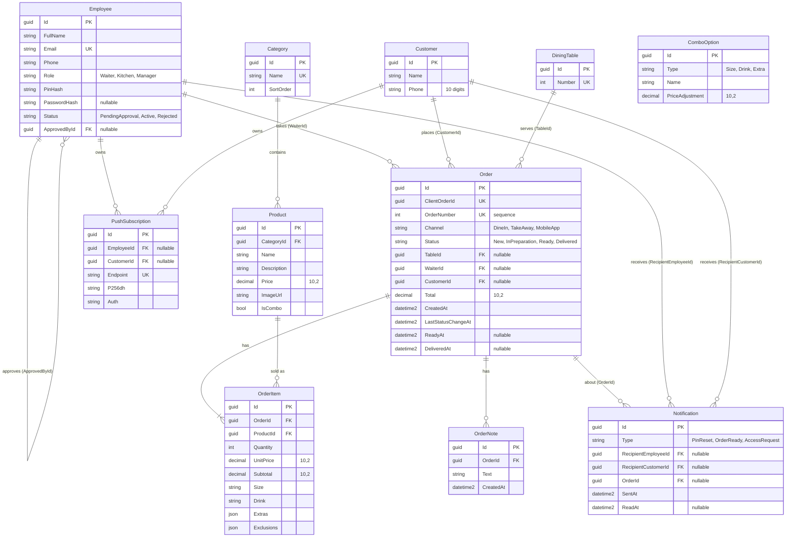

# Database model

The database is Azure SQL (production) and SQL Server 2025 in Docker (local). The model lives in the EF Core code (`Features/*` entities and `Infrastructure/Persistence/Configurations`), and every change reaches the database through a migration. This file explains the decisions that are not obvious from the code.

## Conventions

- **Table names**: plural PascalCase (`Orders`, `OrderItems`), the EF Core default for SQL Server, taken from the `DbSet` name. Columns are PascalCase. No `ToTable` or `HasColumnName` is needed.
- **Keys**: `Guid`, generated by EF Core (sequential values on SQL Server).
- **Timestamps**: every table has `CreatedAt` and `UpdatedAt` (`datetime2`, UTC). `AuditTimestampsInterceptor` sets them on `SaveChanges` using `TimeProvider`. A `CreatedAt` that the caller already set is kept, so an order taken offline keeps the time it was really created.
- **Enums** are stored as text (`HasConversion<string>()`). Every string has a maximum length.
- **Money** is `decimal(10,2)`.
- **Deletes**: nothing cascades except `Order` to `OrderItem` and `OrderNote`. Products, employees, customers, and tables can never be deleted while an order refers to them.

## Entity diagram

`ComboOption` is a catalog of the options a combo offers (sizes, drinks, extras) and their price adjustment. It has no foreign key to `OrderItem`: the item stores the chosen names, not references, so the history does not change if the catalog does.

## Why `ClientOrderId` is unique

The waiter app works offline. A device generates a `Guid` for each order before sending it, and sends it again until the server confirms. Network failures, retries, and Background Sync can deliver the same order several times, even at the same moment from two requests.

The unique index on `ClientOrderId` is what guarantees no duplicates: the API looks the order up by that value first and returns the existing one, and when two requests race, the database rejects the second insert (SQL Server error 2601 or 2627) and the API returns the order that won. A check in code alone would not be enough, because two requests can both pass it before either one saves. `OrderNumber` is a different thing: a sequential, human-readable number for the kitchen and the customer, assigned by the database.

## Why `UnitPrice` is copied into `OrderItem`

`Product.Price` can change tomorrow, but an order taken today must keep what the customer was told. `OrderItem.UnitPrice` copies the price at order time, and `Subtotal` and `Order.Total` are computed from the copy. Reports and past orders never change when the menu is repriced, and the manager's sales totals stay correct. For the same reason the item stores the chosen `Size`, `Drink`, `Extras`, and `Exclusions` as values, not as references to the catalog.