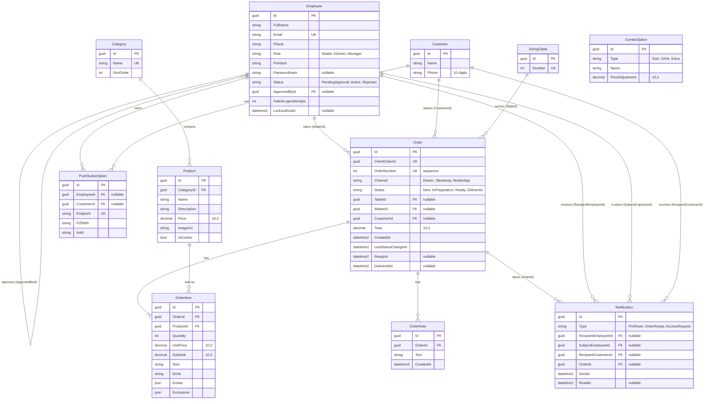

# Database model

The database is Azure SQL (production) and SQL Server 2025 in Docker (local). The model lives in the EF Core code (entities in `src/Itacr.Domain/<Module>/` and their configurations in `src/Itacr.Infrastructure/Persistence/Configurations/`), and every change reaches the database through a migration. This file explains the decisions that are not obvious from the code.

## Conventions

- **Table names**: plural PascalCase (`Orders`, `OrderItems`), the EF Core default for SQL Server, taken from the `DbSet` name. Columns are PascalCase. No `ToTable` or `HasColumnName` is needed.
- **Keys**: `Guid`, generated by EF Core (sequential values on SQL Server).
- **Timestamps**: every table has `CreatedAt` and `UpdatedAt` (`datetime2`, UTC). `AuditTimestampsInterceptor` sets them on `SaveChanges` using `TimeProvider`. A `CreatedAt` that the caller already set is kept, so an order taken offline keeps the time it was really created.
- **Enums** are stored as text (`HasConversion<string>()`). Every string has a maximum length.
- **Money** is `decimal(10,2)`.
- **Deletes**: nothing cascades except `Order` to `OrderItem` and `OrderNote`. Products, employees, customers, and tables can never be deleted while an order refers to them.

## Entity diagram



`ComboOption` is a catalog of the options a combo offers (sizes, drinks, extras) and their price adjustment. It has no foreign key to `OrderItem`: the item stores the chosen names, not references, so the history does not change if the catalog does.

## Why `ClientOrderId` is unique

The waiter app works offline. A device generates a `Guid` for each order before sending it, and sends it again until the server confirms. Network failures, retries, and Background Sync can deliver the same order several times, even at the same moment from two requests.

The unique index on `ClientOrderId` is what guarantees no duplicates: the API looks the order up by that value first and returns the existing one, and when two requests race, the database rejects the second insert (SQL Server error 2601 or 2627) and the API returns the order that won. A check in code alone would not be enough, because two requests can both pass it before either one saves. `OrderNumber` is a different thing: a sequential, human-readable number for the kitchen and the customer, assigned by the database.

## Why `UnitPrice` is copied into `OrderItem`

`Product.Price` can change tomorrow, but an order taken today must keep what the customer was told. `OrderItem.UnitPrice` copies the price at order time, and `Subtotal` and `Order.Total` are computed from the copy. Reports and past orders never change when the menu is repriced, and the manager's sales totals stay correct. For the same reason the item stores the chosen `Size`, `Drink`, `Extras`, and `Exclusions` as values, not as references to the catalog.

## Seed data

Seed data is split in two because the two kinds of data have different needs.

| Data | Where | Environments |
| ---- | ----- | ------------ |
| 5 categories (Combos, Hamburguesas, Complementos, Bebidas, Postres), 18 products, 9 combo options (sizes, drinks, extras), and dining tables 1 to 10 | `Infrastructure/Persistence/Seeding/CatalogSeedData.cs`, loaded with `HasData` in the entity configurations, migration `SeedCatalogData` | All, including production |
| 4 test employees: active waiter, kitchen, and manager, plus a waiter pending approval | `EmployeeSeeder`, registered with `UseSeeding` and `UseAsyncSeeding` | Development only |
| 1 initial manager | `EmployeeSeeder`, from the `Seed` settings | Any environment other than Development |

User-facing names (categories, products, options) are stored in Spanish because the UI shows them as they are. Prices are in MXN.

### Development test logins

Every test employee also has the password `Itacr2026!` for the email and password login.

| Employee          | Email                  | PIN    | Role    | Status          |
| ----------------- | ---------------------- | ------ | ------- | --------------- |
| Mesero de Prueba  | `mesero@itacr.test`    | `1111` | Waiter  | Active          |
| Cocina de Prueba  | `cocina@itacr.test`    | `2222` | Kitchen | Active          |
| Gerente de Prueba | `gerente@itacr.test`   | `3333` | Manager | Active          |
| Mesero Pendiente  | `pendiente@itacr.test` | `4444` | Waiter  | PendingApproval |

The pending waiter is not listed in the login picker (only active employees are), so HU_01 CA4 is checked with the email and password login.

### Why the catalog uses `HasData`

The catalog is the same everywhere, has no secrets, and the app cannot work without it. `HasData` puts it in a migration, so it is versioned, reviewed in the PR, and applied in the same order on every machine and in Azure. The ids and timestamps are fixed constants, so the migration is deterministic and a rerun never duplicates a row. Changing a price later is a new migration, never an edit of an applied one.

### Why employees use a runtime seeder

- Their PINs must be hashed with `PasswordHasher<Employee>` (PBKDF2 with a random salt), which gives a different hash on every run. `HasData` needs fixed values, so it would generate a new migration each time.
- Production credentials must never be in code or in a migration, and they differ per environment. The seeder reads them from configuration and the test employees only exist in Development.
- The seeder checks what exists before it inserts (employees by email, and "a manager exists" for production), so it can run any number of times.

EF Core runs the seeder at the end of `dotnet ef database update` and `Database.MigrateAsync()`. It runs in the environment where the migration is applied, so that process needs the environment name and the `Seed` settings.

### Initial manager in production

The seeder creates the manager only if no manager exists. The settings are:

| Setting | Meaning |
| ------- | ------- |
| `Seed__ManagerName` | Full name |
| `Seed__ManagerEmail` | Email used to sign in |
| `Seed__ManagerPin` | PIN of exactly 4 digits (stored hashed) |

If any setting is missing or the PIN is not 4 digits, the seeder skips the manager and logs a warning (never the PIN). The manager should change the PIN after the first login. The placeholder phone `0000000000` is set because `Phone` is required.

### Verify

```sql
SELECT COUNT(*) FROM dbo.Categories;     -- 5
SELECT COUNT(*) FROM dbo.Products;       -- 18
SELECT COUNT(*) FROM dbo.ComboOptions;   -- 9
SELECT COUNT(*) FROM dbo.DiningTables;   -- 10
SELECT FullName, Email, Role, Status FROM dbo.Employees;
```
