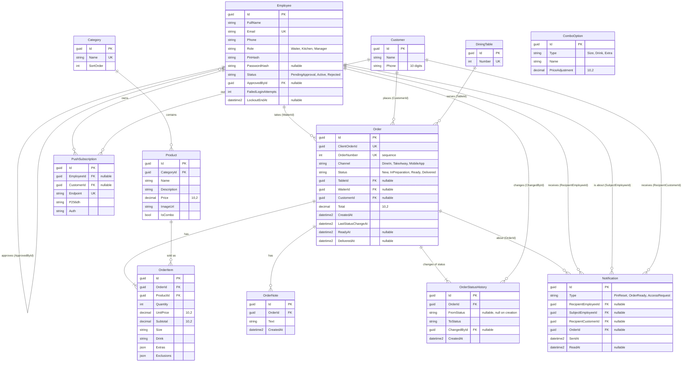

# Database model

The database is Azure SQL (production) and SQL Server 2025 in Docker (local). The schema lives in the SQL scripts of `database/` and reaches every environment through `Itacr.Database.Migrator` ([database/README.md](../database/README.md)). The API reaches it only through stored procedures, called with Dapper from the repositories in `src/Itacr.Infrastructure/Persistence/<Module>/`. This file explains the decisions that are not obvious from the code.

## Conventions

- **Table names**: plural PascalCase (`Orders`, `OrderItems`) in `dbo`. Columns are PascalCase and match the entity properties in `Domain/`, so Dapper maps rows by name.
- **Keys**: `Guid` (`uniqueidentifier`), generated by the repositories with `SequentialGuid.Create()` (sequential values for SQL Server, the same algorithm EF Core used in sprint 1).
- **Timestamps**: every table has `CreatedAt` and `UpdatedAt` (`datetime2`, UTC). The code that writes a row passes them from `TimeProvider` (`@Now` in the procedures); procedures never read the server clock. An order taken offline keeps the `CreatedAt` of the device.
- **Enums** are stored as text (`nvarchar`): the repositories pass `ToString()` and Dapper parses the text back. Every string has a maximum length.
- **Money** is `decimal(10,2)`.
- **Deletes**: nothing cascades except `Order` to `OrderItem`, `OrderNote`, and `OrderStatusHistory`. Products, employees, customers, and tables can never be deleted while an order refers to them.

## Entity diagram



`ComboOption` is a catalog of the options a combo offers (sizes, drinks, extras) and their price adjustment. It has no foreign key to `OrderItem`: the item stores the chosen names, not references, so the history does not change if the catalog does.

## Order lifecycle

An order moves **one step at a time**: `New` → `InPreparation` → `Ready` → `Delivered`. `Delivered` is final and nothing goes back or skips a step. The rules live in `Itacr.Domain/Orders/OrderStatusRules.cs`, and `Order.TryChangeStatus(...)` applies them: it returns `false` and changes nothing when the step is not allowed, so a use case turns that into a `409` `Conflict` error.

Every status change, including the creation of the order, adds a row to `OrderStatusHistory` (`FromStatus` is null on the first row). `Order.TryChangeStatus` also sets `LastStatusChangeAt`, `ReadyAt` (when it becomes `Ready`), and `DeliveredAt` (when it becomes `Delivered`). `ChangedById` is the employee who made the change, or null when the system did.

`Order.Create(...)` builds a new order in `New` with its first history row, and `Order.AddItem(...)` copies the unit price, computes the `Subtotal`, and recalculates `Total`. The repositories generate the keys (`SequentialGuid.Create()`) and the database assigns `OrderNumber`.

The table was added in `database/migrations/V002__add_order_status_history.sql` (ITACR-40).

## Why `ClientOrderId` is unique

The waiter app works offline. A device generates a `Guid` for each order before sending it, and sends it again until the server confirms. Network failures, retries, and Background Sync can deliver the same order several times, even at the same moment from two requests.

The unique index on `ClientOrderId` is what guarantees no duplicates: the API looks the order up by that value first and returns the existing one, and when two requests race, the database rejects the second insert (SQL Server error 2601 or 2627) and the API returns the order that won. A check in code alone would not be enough, because two requests can both pass it before either one saves. `OrderNumber` is a different thing: a sequential, human-readable number for the kitchen and the customer, assigned by the database.

## Why `UnitPrice` is copied into `OrderItem`

`Product.Price` can change tomorrow, but an order taken today must keep what the customer was told. `OrderItem.UnitPrice` copies the price at order time, and `Subtotal` and `Order.Total` are computed from the copy. Reports and past orders never change when the menu is repriced, and the manager's sales totals stay correct. For the same reason the item stores the chosen `Size`, `Drink`, `Extras`, and `Exclusions` as values, not as references to the catalog.

## Seed data

Seed data is split in two because the two kinds of data have different needs.

| Data | Where | Environments |
| ---- | ----- | ------------ |
| 5 categories (Combos, Hamburguesas, Complementos, Bebidas, Postres), 18 products, 9 combo options (sizes, drinks, extras), and dining tables 1 to 10 | `database/migrations/V001__initial_schema.sql` (generated in ITACR-37 from the sprint 1 EF Core seed, with the same fixed IDs as production) | All, including production |
| 4 test employees: active waiter, kitchen, and manager, plus a waiter pending approval | `database/Itacr.Database.Migrator/Seeding/` | Development only |
| 1 initial manager | `database/Itacr.Database.Migrator/Seeding/`, from the `Seed` settings | Any environment other than Development |

User-facing names (categories, products, options) are stored in Spanish because the UI shows them as they are. Prices are in MXN.

### Development test logins

Every test employee also has the password `Itacr2026!` for the email and password login.

| Employee          | Email                  | PIN    | Role    | Status          |
| ----------------- | ---------------------- | ------ | ------- | --------------- |
| Mesero de Prueba  | `mesero@itacr.test`    | `1111` | Waiter  | Active          |
| Cocina de Prueba  | `cocina@itacr.test`    | `2222` | Kitchen | Active          |
| Gerente de Prueba | `gerente@itacr.test`   | `3333` | Manager | Active          |
| Mesero Pendiente  | `pendiente@itacr.test` | `4444` | Waiter  | PendingApproval |

The pending waiter is not listed in the login picker (only active employees are), so HU_01 CA4 is checked with the email and password login.

### Why the catalog is in a migration script

The catalog is the same everywhere, has no secrets, and the app cannot work without it. Being in a migration script, it is versioned, reviewed in the PR, and applied in the same order on every machine and in Azure. The ids and timestamps are fixed constants (the same ones production has had since sprint 1), so the script is deterministic and runs only once. Changing a price later is a new migration script, never an edit of a merged one.

### Why employees are seeded in C#

- Their PINs must be hashed with `PasswordHasher<Employee>` (PBKDF2 with a random salt), the same hasher the API verifies with. A SQL script cannot produce those hashes.
- Production credentials must never be in code or in a migration, and they differ per environment. The seeder reads them from configuration and the test employees only exist in Development.
- The seeder checks what exists before it inserts (employees by email, and "a manager exists" for production), so it can run any number of times.

The migrator runs the seed after the scripts, in the environment it runs in: `Development` with `dotnet run` locally, `Production` in the deploy workflow. That process needs the `Seed` settings only for the first deploy to a new environment.

### Initial manager in production

The seeder creates the manager only if no manager exists. The settings are:

| Setting | Meaning |
| ------- | ------- |
| `Seed__ManagerName` | Full name |
| `Seed__ManagerEmail` | Email used to sign in |
| `Seed__ManagerPin` | PIN of exactly 4 digits (stored hashed) |

If any setting is missing or the PIN is not 4 digits, the seeder skips the manager and logs a warning (never the PIN). The manager should change the PIN after the first login. The placeholder phone `0000000000` is set because `Phone` is required.

### Verify

```sql
SELECT COUNT(*) FROM dbo.Categories;     -- 5
SELECT COUNT(*) FROM dbo.Products;       -- 18
SELECT COUNT(*) FROM dbo.ComboOptions;   -- 9
SELECT COUNT(*) FROM dbo.DiningTables;   -- 10
SELECT FullName, Email, Role, Status FROM dbo.Employees;
```
