# Azure configuration

What runs in Azure for ITACR, how it is configured, who can reach what, and what to do when it breaks. It is the map of the cloud setup; the step by step procedures live in [CONTRIBUTING.md, section 15](../../CONTRIBUTING.md#15-deployment-to-azure) and are linked from here instead of repeated.

> **This file never contains a secret.** It names settings, secrets, users, and resources, never their values. Passwords, the JWT secret, publish profiles, and connection strings with a password live only in a password manager, in GitHub secrets, and in the App Service settings.

Verified against Azure and GitHub on 2026-10-16 (ITACR-34).

## Contents

1. [Overview](#1-overview)
2. [Resources](#2-resources)
3. [Azure SQL](#3-azure-sql)
4. [App Service settings](#4-app-service-settings)
5. [GitHub secrets](#5-github-secrets)
6. [Signing in from GitHub Actions (OIDC)](#6-signing-in-from-github-actions-oidc)
7. [How a deploy works](#7-how-a-deploy-works)
8. [Routine tasks](#8-routine-tasks)
9. [Problems that already happened](#9-problems-that-already-happened)
10. [Related documents](#10-related-documents)

## 1. Overview

Two environments, each with its own backend, frontend, and database. They share one resource group, one App Service plan, and one SQL server.

```mermaid
flowchart LR
    subgraph GitHub
        Main["push to main"]
        Release["push to release"]
    end
    subgraph Azure["Azure, resource group rg-itacr-prod-westus (West US)"]
        direction TB
        Plan["App Service plan asp-itacr-prod-westus (F1, Linux)"]
        subgraph Prod["Production"]
            BP["app-itacr-backend-prod"]
            FP["app-itacr-frontend-prod"]
        end
        subgraph Qa["QA"]
            BQ["app-itacr-backend-qa"]
            FQ["app-itacr-frontend-qa"]
        end
        SQL[("SQL server itacr-sql<br/>databases itacr-sql and itacr-qa")]
    end
    Main -->|"OIDC + migrator + publish profile"| BP
    Main -->|"publish profile"| FP
    Release -->|"OIDC + migrator + publish profile"| BQ
    Release -->|"publish profile"| FQ
    BP --> SQL
    BQ --> SQL
    FP -.->|"HTTPS API calls from the browser"| BP
    FQ -.->|"HTTPS API calls from the browser"| BQ
```



| Branch | Environment | Deployed to |
| ------ | ----------- | ----------- |
| `main` | Production | `app-itacr-backend-prod`, `app-itacr-frontend-prod`, database `itacr-sql` |
| `release` | QA | `app-itacr-backend-qa`, `app-itacr-frontend-qa`, database `itacr-qa` |

`develop` and the `sprint-XX` branches deploy nothing. The branch flow is in [CONTRIBUTING.md, section 2](../../CONTRIBUTING.md#2-branching-model).

## 2. Resources

Everything is created by hand in the Azure Portal. No repository creates or changes Azure resources.

| Item | Value |
| ---- | ----- |
| Subscription | Azure for Students (the ID is in the GitHub secret `AZURE_SUBSCRIPTION_ID`) |
| Resource group | `rg-itacr-prod-westus` |
| Region | **West US**, for every resource |
| App Service plan | `asp-itacr-prod-westus`, tier **F1** (free), Linux. The four apps share it |

**Region.** Create anything new in West US too: it is the region of the resource group and of the free offers in use. Whether the subscription allows other regions was not verified; check the allowed regions in the Portal before creating a resource somewhere else.

### 2.1 App Services

| App | Runtime | Role | URL |
| --- | ------- | ---- | --- |
| `app-itacr-backend-prod` | .NET 10 | API, production | `https://app-itacr-backend-prod-b3hvcggncghafbgp.westus-01.azurewebsites.net` |
| `app-itacr-frontend-prod` | Node 24 | PWA, production | `https://app-itacr-frontend-prod-hchjfvaadffrhre3.westus-01.azurewebsites.net` |
| `app-itacr-backend-qa` | .NET 10 | API, QA (ITACR-43) | `https://app-itacr-backend-qa.azurewebsites.net` |
| `app-itacr-frontend-qa` | Node 24 | PWA, QA (ITACR-43) | `https://app-itacr-frontend-qa.azurewebsites.net` |

- The two production URLs have a unique suffix that Azure generated; each one is in the app's **Overview** > **Default domain**. The API answers under `/api/v1` and the health check is `GET /api/v1/health`.
- **Every app:** HTTPS only, minimum TLS 1.2, FTP disabled. The backend of production also has WebSockets on, for the real-time channel planned for later sprints.
- **Frontends** have no application settings. Their startup command serves the built PWA as a single page app:

  ```
  pm2 serve /home/site/wwwroot --no-daemon --spa
  ```

  `--spa` sends every unknown path to `index.html`, so a refresh on `/kitchen` or `/pickup/orders` works.

### 2.2 What the free tier means

- All four apps share the CPU quota of one **F1** plan, which has a daily limit and no Always On. After idle time the first request is slow (a cold start), and a busy day can pause the apps until the quota resets.
- The free serverless **Azure SQL** databases pause when idle. The first request after a pause can take up to a minute; the connection strings use `Connection Timeout=60`, and the API retries the opening of the connection.
- None of this is a bug. Before a demo, open the health check once to wake the stack (section 9).

## 3. Azure SQL

| Item | Value |
| ---- | ----- |
| Server | `itacr-sql.database.windows.net` |
| Databases | `itacr-sql` (production) and `itacr-qa` (QA, ITACR-43), both on the free serverless offer (`GP_S_Gen5`) |
| Admin login | Used by nobody and nothing. Only for emergencies, kept in the password manager |

### 3.1 Firewall

| Rule | Why |
| ---- | --- |
| `AllowAllWindowsAzureIps` | Lets the App Services reach the server |
| Personal rule with the IP of Julián | SSMS or Query editor from his machine |
| Temporary rule for the runner | Created by the `migrate` job of the deploy for the IP of the GitHub runner, and deleted when the job ends, even if the migrator failed |

Add your own IP only while you need it and delete it afterwards ([CONTRIBUTING.md, section 15.4](../../CONTRIBUTING.md#154-run-the-migrator-against-azure-sql-by-hand)).

### 3.2 Database users

Each database has its own two users, with **different passwords in `itacr-sql` and `itacr-qa`**. Only Julián keeps the passwords.

| User | Permissions | Used by |
| ---- | ----------- | ------- |
| `itacr_migrator` | `db_ddladmin`, `db_datareader`, `db_datawriter`: changes the schema | Only the migrator, in the deploy workflow |
| `itacr_app` | `EXECUTE` on `dbo` and nothing else | The API, through the connection string `Default` |

The API reaches data only through stored procedures, so a bug or an injection in the API cannot read or write a table directly. The users are created by hand with `database/scripts/security/database-users.sql`; `app-execute-only.sql` removes the old table rights. Both are in [database/scripts/security/](../../database/scripts/security/), and the procedure is in [CONTRIBUTING.md, section 15.3](../../CONTRIBUTING.md#153-database-access-from-the-workflow). A test (`DatabasePermissionsTests`) checks that the API user cannot touch a table.

**Password rule of Azure SQL:** the password cannot contain parts of the user name (`itacr`, `migrator`, `app`). It was rejected for that reason once (section 9).

## 4. App Service settings

Only the two **backend** apps have settings. They are set in the app's **Settings** > **Environment variables** and are never in the repository. The API validates them at startup and does not start if one is missing (the log stream says which one).

| Setting | Where | What it is |
| ------- | ----- | ---------- |
| `ASPNETCORE_ENVIRONMENT` | App setting, `Production` in both prod and QA | Selects the production behavior (no OpenAPI or Scalar, HSTS, JSON logs) |
| `ConnectionStrings__Default` | **Connection string**, type `SQLAzure` | The full connection string to its database with the user `itacr_app` (`itacr-sql` for production, `itacr-qa` for QA) |
| `Jwt__Secret` | App setting | Signs the session tokens. Random, at least 64 characters, **different in production and in QA** |
| `Cors__Origins__0` | App setting | The URL of its own frontend (the production frontend for production, the QA frontend for QA) |
| `WEBSITE_HTTPLOGGING_RETENTION_DAYS` | App setting | How many days the platform keeps the HTTP logs |

- `Cors:Origins` is a list, so each origin is its own variable (`Cors__Origins__0`, `Cors__Origins__1`, ...). A single `Cors__Origins` is ignored and the API does not start.
- `ConnectionStrings__Default` must be the **whole** string, not only the password. The shape is in [README: Production settings](../../README.md#production-settings).
- The seed of the test employees in QA is not an App Service setting: the deploy workflow sets `Seed__TestEmployees=true` for the migrator only when it runs on `release`.
- The optional limits (`PublicOrders`, `LoginSecurity`, `RateLimiting`) have defaults in `appsettings.json` and are overridden with the same double underscore names when needed, for example `PublicOrders__MaxActiveOrdersPerPhone`.

## 5. GitHub secrets

Set in each repository: **Settings** > **Secrets and variables** > **Actions**. They are write-only in GitHub: to change one, paste the new value.

### 5.1 itacr-backend

| Secret | Used by | What it is |
| ------ | ------- | ---------- |
| `AZURE_CLIENT_ID` | `migrate` job | Application (client) ID of the app registration `github-itacr-backend-deploy` |
| `AZURE_TENANT_ID` | `migrate` job | Directory (tenant) ID |
| `AZURE_SUBSCRIPTION_ID` | `migrate` job | Subscription ID |
| `SQL_MIGRATOR_CONNECTION_STRING` | `migrate` on `main` | Connection string of `itacr_migrator` for the production database |
| `SQL_MIGRATOR_QA_CONNECTION_STRING` | `migrate` on `release` | The same for `itacr-qa`, with its own password |
| `AZURE_WEBAPP_PUBLISH_PROFILE` | `deploy` on `main` | Publish profile of `app-itacr-backend-prod` |
| `AZURE_WEBAPP_QA_PUBLISH_PROFILE` | `deploy` on `release` | Publish profile of `app-itacr-backend-qa` |
| `RELEASE_PLEASE_TOKEN` | `release-please.yml` | Token that lets release-please open its release PR |

### 5.2 itacr-frontend

| Secret | Used by | What it is |
| ------ | ------- | ---------- |
| `AZURE_FRONTEND_PUBLISH_PROFILE` | `deploy` on `main` | Publish profile of `app-itacr-frontend-prod` |
| `AZURE_FRONTEND_QA_PUBLISH_PROFILE` | `deploy` on `release` | Publish profile of `app-itacr-frontend-qa` |
| `RELEASE_PLEASE_TOKEN` | `release-please.yml` | Same purpose as in the backend |

The frontend needs no Azure sign-in and no database secret: it only uploads files with a publish profile.

## 6. Signing in from GitHub Actions (OIDC)

The `migrate` job needs to open and close a firewall rule on the SQL server. It does it with **OpenID Connect**, so GitHub never stores an Azure password.

| Item | Value |
| ---- | ----- |
| App registration | `github-itacr-backend-deploy` |
| Role | **SQL Server Contributor** on the server `itacr-sql`, and nothing else (it only has to manage the temporary firewall rule) |
| Federated credentials | `itacr-backend-main-ids` for the branch `main` and `itacr-backend-release-ids` for the branch `release` |
| Legacy credential | `itacr-backend-main`, kept in case GitHub goes back to the old subject format |

Because there is one credential per branch, only a run on `main` or on `release` can sign in; a run on any other branch cannot.

**Subject format.** GitHub changed the subject of the token to include the numeric IDs of the owner and the repository. The credentials use the new format:

```
repo:JulianH2@<owner id>/itacr-backend@<repository id>:ref:refs/heads/<branch>
```

The old format, `repo:JulianH2/itacr-backend:ref:refs/heads/<branch>`, no longer matches; that mismatch is the error described in section 9.

## 7. How a deploy works

| | Backend (`deploy.yml`) | Frontend (`deploy.yml`) |
| - | ---------------------- | ----------------------- |
| Trigger | Push to `main` (production) or `release` (QA), or **Run workflow** by hand from either branch | Same |
| Steps | `build` (restore, build, tests) → `migrate` (OIDC, temporary firewall rule, DbUp as `itacr_migrator`) → `deploy` (publish profile) | `test` → `build` (`npm run build` on `main`, `npm run build:qa` on `release`) → `deploy` (publish profile) |
| If a step fails | The next one does not start: a failed migration means the API is **not** deployed | The same |
| Runs every PR | `ci.yml`: format, build, tests, commit and branch name checks | `ci.yml`: lint, format, tests, build, and the same checks |

The database is migrated **before** the new API starts, so every migration script must be additive: for a moment the previous API runs against the new schema. The details of the backend workflow, the QA differences, and the one-time setup are in [CONTRIBUTING.md, section 15.2](../../CONTRIBUTING.md#152-deploy-workflow). The frontend side is in the "Production" and "QA" sections of the README of `itacr-frontend`.

**Order of a release that adds a public endpoint.** Release the backend first, or both in the same window: if the frontend goes first, the app shows a feature whose endpoint does not exist yet (this happened with the pickup order flow, ITACR-12).

**After every deploy**, open `GET /api/v1/health` of the environment: it must answer `200 Healthy`. It can answer `500` for a few seconds while the app restarts; wait and try again before looking for a cause.

## 8. Routine tasks

| Task | How |
| ---- | --- |
| Add or change an app setting | App Service > **Settings** > **Environment variables**. Saving restarts the app. Check the health check afterwards |
| Rotate `Jwt__Secret` | Generate a new random value of 64 or more characters and save it in the App Service of that environment only. **Every session ends**, so everyone signs in again |
| Rotate a database password | Change it in SQL (`ALTER USER ... WITH PASSWORD`), then update the secret or the App Service connection string that uses it right away. Expect a short interruption in the API while it restarts. Never reuse a password between `itacr-sql` and `itacr-qa` |
| Renew a publish profile | App Service > **Overview** > **Download publish profile** (reset it first if it leaked), paste the whole file into the GitHub secret, and delete the downloaded file |
| Run the migrator by hand | Only if the workflow cannot: [CONTRIBUTING.md, section 15.4](../../CONTRIBUTING.md#154-run-the-migrator-against-azure-sql-by-hand) |
| Create the database users | [CONTRIBUTING.md, section 15.3](../../CONTRIBUTING.md#153-database-access-from-the-workflow) |
| Add the QA test employees | They come from the deploy of `release` (`Seed__TestEmployees=true`); nothing to do by hand |

## 9. Problems that already happened

| Symptom | Cause | Fix |
| ------- | ----- | --- |
| The `migrate` job fails at the Azure login with `AADSTS700213` | GitHub changed the subject of the OIDC token to include the owner and repository IDs, and the federated credential had the old format | Create the credential with the new subject format (`itacr-backend-main-ids`, `itacr-backend-release-ids`, section 6) |
| The API answers `503` or `500` and the log says `Format of the initialization string does not conform to specification` | `ConnectionStrings__Default` was incomplete: only the password was pasted | The value must be the **full** connection string (server, database, user, password, `Encrypt`, timeout). Save, wait for the restart, check `/api/v1/health` |
| Azure SQL rejects the password when creating a user | A password cannot contain parts of the user name (`itacr`, `migrator`, `app`) | Generate another password without those words |
| `GET /api/v1/health` answers `500` right after a deploy | The app is restarting | Wait a few seconds and try again. It only matters if it lasts |
| The first request after a while is very slow or fails once | F1 cold start and the paused serverless database (section 2.2) | Repeat the request; the health check wakes both |

When something else breaks, look at **Monitoring** > **Log stream** of the App Service first: the API logs which setting is missing at startup.

## 10. Related documents

- [CONTRIBUTING.md, section 15](../../CONTRIBUTING.md#15-deployment-to-azure): deploy workflow, database users, OIDC, QA, and the manual migrator
- [README: Deployment](../../README.md#deployment): production URLs and settings
- [database/README.md](../../database/README.md): the migrator, the scripts, and the database users
- [ARCHITECTURE.md, sections 6 and 8](../ARCHITECTURE.md): security and deployment
- [SECURITY.md](../../SECURITY.md): how to report a vulnerability
